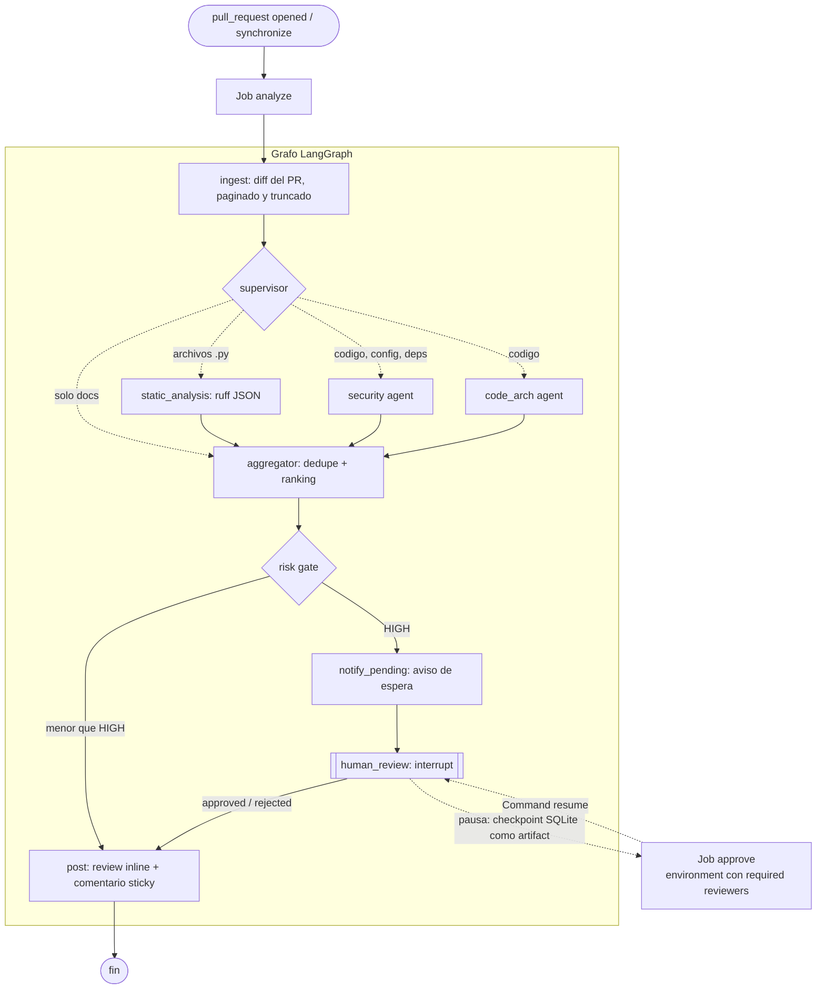

# agent-langgraph — PR Review Agent

Un bot de revisión de Pull Requests multi-agente construido con **LangGraph**,
disparado por GitHub Actions. Sin servidor corriendo, sin costo de
infraestructura: el grafo se ejecuta como un job efímero de CI y termina.

## Por qué existe esto

La mayoría de los demos de "AI code review" son un solo prompt disfrazado de
chat. Este proyecto es un ejercicio real de orquestación: un supervisor
enruta el trabajo a revisores especializados solo cuando corresponde, los
hallazgos se agregan y se ordenan por severidad, y los de severidad alta
pausan el grafo (`interrupt()`) hasta que un humano aprueba desde GitHub —
en otro job, en otro runner, reanudando el mismo checkpoint.

Documentos que gobiernan el proyecto:

- [docs/SPEC.md](docs/SPEC.md) — qué hace y por qué.
- [docs/Constitution.md](docs/Constitution.md) — reglas innegociables.
- [docs/Tasks.md](docs/Tasks.md) — plan de ejecución verificable.

## Flujo



La topología compilada exacta está en [docs/graph.mmd](docs/graph.mmd); se
regenera con `uv run visualize-graph`.

- El **supervisor** activa solo lo que el diff necesita: un cambio de solo
  documentación no llama a ningún revisor; un `Dockerfile` o un
  `requirements.txt` activa seguridad pero no arquitectura.
- **static_analysis** (ruff), **security** y **code_arch** corren como un
  fan-out paralelo real y escriben a la misma lista `findings` mediante un
  reducer.
- Los agentes LLM devuelven **salida estructurada** validada contra un
  schema. Si un agente falla, el comentario lo dice ("revisión incompleta");
  un fallo nunca se publica como "sin problemas".
- El **risk gate** enruta los veredictos de severidad alta a `human_review`.
  El PR ve un aviso de "esperando aprobación" y los detalles se publican
  recién cuando un maintainer aprueba.
- La publicación es **idempotente**: un único comentario resumen que se
  actualiza en cada push, más comentarios inline sobre las líneas del diff.

## Arquitectura

Hexagonal / puertos y adaptadores, así reemplazar GitHub REST por un
adaptador basado en MCP, o Gemini por otro modelo, es cambiar un archivo:

```
src/agent_langgraph/
  domain/         # datos puros, utilidades de diff, puertos (Protocol), errores
  application/    # el grafo de LangGraph, un nodo por archivo, prompts, rendering
  adapters/       # GitHub REST, Gemini, ruff
  entrypoints/    # composition root: settings, CLI, GitHub Actions, evals
  evals/          # dataset loader y scoring
evals/dataset.jsonl
tests/unit, tests/integration
```

## Stack

- Python 3.12, manejado con `uv`
- LangGraph para el grafo, checkpointer SQLite para pausar/reanudar
- LLM intercambiable: Gemini (`gemini-2.5-flash`) o cualquier API compatible con OpenAI
- API REST de GitHub
- `ruff` para análisis estático (ese nodo no llama al LLM)

## Setup

```bash
uv sync
cp .env.example .env   # completar GITHUB_TOKEN y la key del proveedor de LLM
```

## Correr localmente

```bash
uv run review run --repo owner/name --pr 12
```

Si hay hallazgos de severidad alta, la CLI muestra la revisión completa y
pregunta antes de publicar. En modo no interactivo imprime el `thread_id`
para decidir después:

```bash
uv run review resume --thread '<thread_id>' --approve   # o --reject
```

## CI

| Workflow | Cuándo | Qué hace |
|---|---|---|
| `review.yml` | lo llaman otros workflows | Reutilizable. Job `analyze` corre el grafo; si pausa, sube el checkpoint. Job `approve` espera aprobación y reanuda. |
| `pr-review.yml` | cada PR de este repo | Llama a `review.yml` para revisar los PRs del propio agente. |
| `ci.yml` | push a `main` y PRs | `ruff check`, `ruff format --check`, `mypy`, `pytest`. |
| `evals.yml` | manual | Corre las evals contra el modelo real. |

Configuración necesaria, una sola vez:

1. Secret del repo `GEMINI_API_KEY`.
2. *Settings → Environments → New environment* llamado **`review-approval`**,
   con *Required reviewers*. Sin reviewers configurados, el job `approve`
   corre sin esperar y los hallazgos HIGH se publican directo.

El agente corre desde la rama base y trata el head del PR como datos: lo lee
y lo lintea, nunca lo ejecuta. Por eso el PR que *introduce* un cambio en el
agente se revisa con la versión anterior.

## Elegir el modelo

Por defecto usa Gemini. Para cualquier API compatible con OpenAI (OpenCode
Zen, OpenRouter, DeepSeek) se configura sin tocar código:

| Dónde | Qué |
|---|---|
| Local (`.env`) | `LLM_PROVIDER=openai-compatible`, `LLM_API_KEY`, `LLM_BASE_URL`, `LLM_MODEL` |
| GitHub, secret | `LLM_API_KEY` |
| GitHub, variables (*Settings → Secrets and variables → Actions → Variables*) | `LLM_PROVIDER`, `LLM_BASE_URL`, `LLM_MODEL` |

Ejemplo con OpenCode Zen: `LLM_BASE_URL=https://opencode.ai/zen/v1` y en
`LLM_MODEL` el id de un modelo que use el endpoint `/chat/completions`.

Con Gemini la API impone el schema de salida; con el resto el schema va en el
prompt y la respuesta se valida al recibirla. Un modelo que responde mal
produce "revisión incompleta", no un falso limpio — pero **cada modelo nuevo
exige correr las evals** antes de confiar en sus revisiones.

## Configurar qué se revisa

Cada repo puede tener un `.pr-review.yml` opcional en su raíz:

```yaml
reviewers:
  code_arch: false          # apagar un revisor (static_analysis, security, code_arch)
ignore:
  - "migrations/"           # un árbol entero
  - "*.lock"                # glob sobre el path completo
gate_severity: medium       # desde qué severidad se pide aprobación humana
rules:                      # reglas propias del repo, en texto
  - "Toda ruta nueva bajo /api debe exigir autenticación."
  - "Nunca loguear emails ni tokens."
```

Se lee de la **rama base** del PR, no del PR: un cambio a este archivo recién
aplica después de mergearse, así nadie puede apagar la revisión de su propio
PR. Si el archivo tiene un error, se revisa con los valores por defecto y el
comentario lo avisa.

## Usarlo en otro repo

En el repo que quieres revisar:

1. Crea `.github/workflows/pr-review.yml`:

   ```yaml
   name: PR Review Agent
   on:
     pull_request:
       types: [opened, synchronize, reopened]
   permissions:
     contents: read
     pull-requests: write
   jobs:
     review:
       uses: fabrizzio178/PR-agents-reviewer/.github/workflows/review.yml@main
       with:
         llm_provider: gemini          # u openai-compatible + llm_base_url + llm_model
       secrets:
         GEMINI_API_KEY: ${{ secrets.GEMINI_API_KEY }}
         # LLM_API_KEY: ${{ secrets.LLM_API_KEY }}
   ```

2. Carga en ese repo el secret de la key que uses.
3. Crea ahí el Environment `review-approval` con *Required reviewers*.

Inputs opcionales: `agent_ref` (fijar un tag o SHA del agente en vez de
`main`), `gate_severity` y `approval_environment`. El análisis estático solo
cubre Python; los agentes LLM revisan cualquier lenguaje que el supervisor
reconozca.

## Calidad

```bash
uv run ruff check && uv run ruff format --check && uv run mypy && uv run pytest
```

Los tests no usan red ni credenciales: el grafo completo corre contra
implementaciones en memoria de los puertos, incluida la reanudación desde
SQLite en un proceso nuevo.

## Evals

`evals/dataset.jsonl` tiene diffs pequeños con el hallazgo que un revisor
competente debe reportar (secretos, SQL injection, auth faltante, un intento
de prompt injection, breaking changes) y casos limpios para medir falsos
positivos.

```bash
uv run eval                 # tabla de recall/precision por agente
uv run eval --fail-under    # exit 1 si no cumple los umbrales del SPEC
```

Cambiar un prompt o el modelo exige correr las evals (Constitution §10).

## Observabilidad

Cada nodo emite una línea JSON a stderr con su nombre, resultado y duración.
El comentario publicado incluye los tokens consumidos. Para trazas completas,
definir `LANGSMITH_TRACING=true` y `LANGSMITH_API_KEY`.

## Roadmap

- [ ] Adaptador de GitHub basado en el MCP server oficial
- [ ] Analizadores estáticos por lenguaje más allá de `ruff`
- [ ] Sugerencias aplicables (`suggestion` blocks) en los comentarios inline
- [ ] Contexto del repositorio más allá del diff (archivos relacionados)
