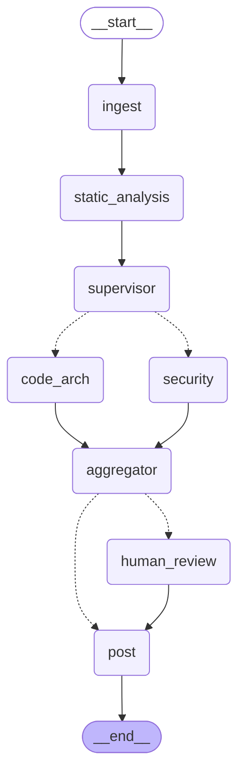

# agent-langgraph — PR Review Agent

Un bot de revisión de código multi-agente construido con **LangGraph**,
disparado por GitHub Actions en cada push. Sin servidor corriendo, sin costo
de infraestructura: el grafo se ejecuta como un job efímero de CI y termina.

## Por qué existe esto

La mayoría de los demos de "AI code review" son un solo prompt disfrazado de
chat. Este proyecto es un ejercicio real de orquestación: un supervisor
enruta el trabajo a agentes especializados solo cuando corresponde, los
hallazgos se agregan y se ordenan por severidad, y los resultados de
severidad alta pausan el grafo para que decida un humano (`interrupt()`) en
vez de postear automáticamente.

## Arquitectura

Hexagonal / puertos y adaptadores, así reemplazar GitHub REST por un
adaptador basado en MCP más adelante es cambiar un solo archivo:

```
src/agent_langgraph/
  domain/         # datos puros (GraphState, Finding, Severity) + puertos (Protocol)
  application/    # el grafo de LangGraph en sí + un nodo por archivo
  adapters/       # implementaciones concretas de los puertos (GitHub REST, Gemini, ruff)
  entrypoints/    # composition root: CLI para correr local, entrypoint de GitHub Actions
```

## Grafo de decisiones



Para regenerar este diagrama cada vez que cambie el grafo: `uv run
visualize-graph` (escribe `docs/graph.mmd`).

- El **supervisor** solo activa el agente de `security` cuando el diff toca
  archivos de código/config — un cambio de solo documentación lo salta.
- **security** y **code_arch** corren como un fan-out paralelo real (edges
  condicionales de LangGraph devolviendo múltiples claves), y cada uno
  escribe a la misma lista `findings` mediante un reducer `operator.add`.
- El **risk gate** (un edge condicional, no un nodo) enruta los veredictos
  de severidad alta a `human_review`, que llama a `interrupt()` — el grafo
  se suspende de verdad hasta que un humano lo reanuda con una decisión de
  aprobación. Esto requiere el checkpointer de SQLite para persistir el
  estado durante la pausa.

## Stack

- Python 3.12, manejado con `uv`
- LangGraph (SDK oficial) para el grafo/máquina de estados
- Gemini (`gemini-2.5-flash`, vía Google AI Studio) como LLM — tier gratuito, sin suscripción
- API REST de GitHub para traer el diff y comentar (MVP: sin MCP todavía)
- `ruff` para análisis estático (ese nodo no llama al LLM)

## Setup

```bash
uv sync
cp .env.example .env   # completar GITHUB_TOKEN y GEMINI_API_KEY
```

## Correr localmente

```bash
uv run review --repo owner/name --sha <commit_sha>
```

Si un hallazgo de severidad alta dispara revisión humana, la CLI imprime el
resumen y pregunta por la aprobación antes de postear.

## CI

`.github/workflows/pr-review.yml` corre el agente en cada push a una rama
que no sea `main`, usando `GEMINI_API_KEY` como secret del repo. Sin
servidores, sin costo de idle — es un job, no un servicio.

## Roadmap

- [ ] Reemplazar el adaptador REST de GitHub por el MCP server oficial de GitHub
- [ ] Canal de aprobación asíncrono real (Slack/GitHub check-run) en vez del
      resume solo-por-CLI actual
- [ ] Analizadores estáticos por lenguaje más allá de `ruff`
