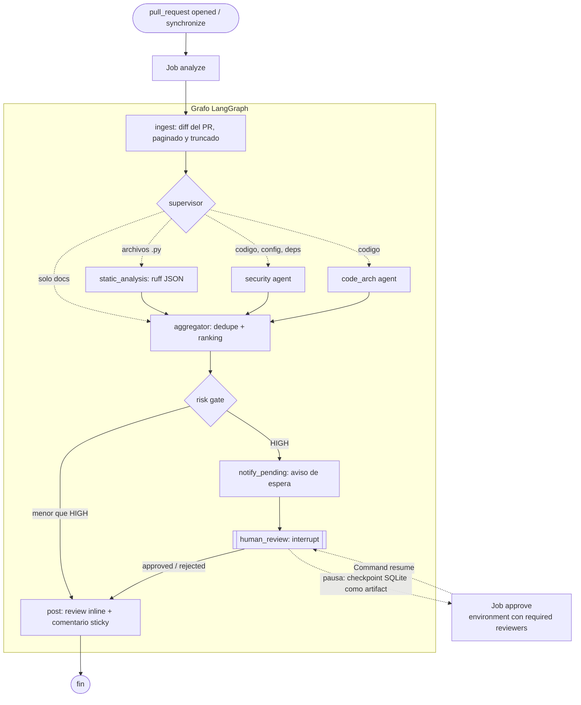

# SPEC — PR Review Agent

Qué construimos y por qué. Las reglas que no se negocian están en
[Constitution.md](Constitution.md); el plan de ejecución en [Tasks.md](Tasks.md).

## 1. Problema

Los revisores humanos llegan tarde a los PR y gastan atención en lo mecánico
(un secreto hardcodeado, un import muerto, un cambio de firma que rompe a
terceros). Los bots de "AI review" habituales son un único prompt: no
distinguen un cambio de documentación de uno de autenticación, publican
cualquier cosa que el modelo diga, y cuando el modelo falla responden "todo
bien".

## 2. Qué es

Un agente de revisión de Pull Requests construido con LangGraph que corre como
job efímero de GitHub Actions:

- Un **supervisor** decide en runtime qué especialistas activar según lo que
  toca el diff.
- Tres ramas paralelas — **análisis estático** (ruff, sin LLM), **seguridad**
  y **código/arquitectura** (LLM con salida estructurada) — escriben
  hallazgos a un mismo estado.
- Un **aggregator** deduplica y ordena por severidad.
- Un **risk gate** publica directo lo de severidad baja/media y **pausa el
  grafo** (`interrupt()`) cuando hay severidad alta, hasta que un humano
  apruebe desde GitHub.
- La publicación es **idempotente**: un comentario resumen que se actualiza
  en cada push y comentarios inline sobre las líneas del diff.

## 3. Por qué así

| Decisión | Motivo |
|---|---|
| Grafo con supervisor en vez de un prompt | Costo y ruido proporcionales al cambio: un PR de docs no llama al LLM. |
| Job de CI, sin servidor | Cero infraestructura y cero costo en idle. |
| Human-in-the-loop en severidad alta | Un falso positivo "HIGH" publicado por un bot erosiona la confianza; uno verdadero merece ojos humanos antes de hacerse público en el PR. |
| Salida estructurada (JSON Schema) | Un fallo de formato es un error detectable, no un falso "limpio". Con Gemini el schema lo impone la API; con proveedores compatibles con OpenAI va en el prompt y se valida igual al recibir. |
| Workflow reutilizable (`workflow_call`) | Otros repos lo llaman con pocas líneas en vez de copiar el agente. |
| Hexagonal (puertos/adaptadores) | El grafo se testea completo sin red; cambiar GitHub REST por MCP o Gemini por otro modelo es un archivo. |
| Evals versionadas | Un cambio de prompt sin medición es una opinión. |

## 4. Usuarios

- **Autor del PR**: recibe feedback accionable en minutos, sobre la línea.
- **Revisor/maintainer**: aprueba o descarta la publicación de hallazgos de
  severidad alta desde la UI de GitHub.
- **Quien mantiene el agente**: itera prompts y routing con tests y evals.

## 5. Alcance

**Incluye**

- Revisión de PRs del mismo repositorio (eventos `opened`, `synchronize`,
  `reopened`).
- Ejecución local por CLI contra cualquier PR accesible con el token.
- Análisis estático de Python con ruff sobre las líneas agregadas.
- Aprobación humana asíncrona vía GitHub Environments.
- Suite de evals offline con precision/recall por agente.

**No incluye (por ahora)**

- PRs desde forks (no reciben secrets; ver §9).
- Revisión de commits sueltos fuera de un PR.
- Analizadores estáticos para otros lenguajes.
- Auto-fix o sugerencias aplicables (`suggestion` blocks).
- Memoria entre PRs o contexto del repositorio más allá del diff.

## 6. Flujo



La topología exacta compilada se regenera en [graph.mmd](graph.mmd) con
`uv run visualize-graph`.

### Pausa y reanudación entre procesos

1. `analyze` ejecuta el grafo con un checkpointer SQLite. Si el risk gate
   enruta a `human_review`, `interrupt()` suspende la ejecución y el job
   termina exitosamente con `paused=true`.
2. El archivo SQLite se sube como artifact (retención: 1 día).
3. `approve` depende de un Environment (`review-approval`) con required
   reviewers. GitHub lo deja en espera hasta que alguien aprueba.
4. Al aprobar, el job descarga el artifact y reanuda el mismo `thread_id` con
   `Command(resume={"approved": true})`. Solo corren `human_review` y `post`:
   no se vuelve a llamar al LLM.
5. Si nadie aprueba o se rechaza el deployment, el comentario queda en
   "esperando aprobación" y los hallazgos no se publican.

## 7. Contratos

### Estado (`GraphState`)

| Campo | Tipo | Lo escribe | Notas |
|---|---|---|---|
| `target` | `ReviewTarget(repo, pr_number, head_sha)` | entrada | |
| `repo_config`, `config_warning` | `RepoConfig`, `str` | ingest | De `.pr-review.yml` en la rama base. |
| `files` | `list[FileChange]` | ingest | Sin los paths ignorados y con presupuesto aplicado. |
| `truncated_files` | `list[str]` | ingest | Paths recortados u omitidos. |
| `active_agents` | `list[str]` | supervisor | Vacío = solo docs. |
| `findings` | `list[Finding]` + reducer `add` | ramas paralelas | |
| `agent_errors` | `list[str]` + reducer `add` | ramas paralelas | Una rama que falla no aborta el grafo. |
| `usage` | `TokenUsage` + reducer `add` | agentes LLM | |
| `verdict` | `ReviewVerdict` | aggregator | |
| `human_approved` | `bool \| None` | human_review | `None` = no hizo falta. |
| `comment_body`, `posted` | `str`, `bool` | post | |

### Nodos

| Nodo | Entrada → salida | Efectos externos |
|---|---|---|
| `ingest` | `target` → `files`, `truncated_files` | GET GitHub (con retry) |
| `supervisor` | `files` → `active_agents` | ninguno, determinista |
| `static_analysis` | `files` → `findings` \| `agent_errors` | subprocess ruff |
| `security`, `code_arch` | `files` → `findings`, `usage` \| `agent_errors` | LLM |
| `aggregator` | `findings` → `verdict` | ninguno |
| `notify_pending` | `verdict` → — | upsert comentario sticky |
| `human_review` | `verdict` → `human_approved` | **ninguno** (`interrupt()`) |
| `post` | todo → `comment_body`, `posted` | upsert sticky + review inline |

### Hallazgo

`Finding(agent, file, line | None, message, severity ∈ {low, medium, high})`.
`line` refiere a la numeración del archivo nuevo. Un hallazgo va inline solo
si `(file, line)` está dentro de un hunk del diff; si no, aparece únicamente
en el resumen.

### Comentario publicado

- **Resumen sticky**: identificado por un marcador HTML oculto; se crea una
  vez y luego se actualiza. Contiene conteo por severidad, hallazgos
  agrupados, sección "revisión incompleta" si algún agente falló, archivos
  truncados y uso de tokens.
- **Inline**: un review `COMMENT` con un comentario por hallazgo ubicable. No
  se re-publica un comentario idéntico ya existente en la misma línea.

### Configuración por repo (`.pr-review.yml`)

Archivo opcional en la raíz del repo revisado. Se lee del commit base del PR.

```yaml
reviewers:            # todos activos por defecto
  static_analysis: true
  security: true
  code_arch: false
ignore:               # globs sobre el path completo; "dir/" ignora el árbol
  - "migrations/"
  - "*.lock"
gate_severity: high   # low | medium | high
rules:                # hasta 20, 300 caracteres c/u; van al prompt de sistema
  - "Nunca loguear emails ni tokens."
```

Claves desconocidas o valores inválidos invalidan el archivo entero: se
revisa con los defaults y el resumen lo informa. `gate_severity` del archivo
tiene prioridad sobre el input del workflow.

## 8. Requisitos no funcionales

- **Costo**: opera dentro del tier gratuito de Gemini. Máximo 2 llamadas LLM
  por ejecución; 0 para PRs de solo documentación.
- **Presupuesto de diff**: 20 000 caracteres por archivo y 120 000 en total
  (configurable). Lo que excede se recorta y se informa en el comentario.
- **Resiliencia**: reintentos con backoff en 429/5xx (LLM y GitHub). Un
  agente que agota reintentos degrada la revisión, no la aborta.
- **Tiempo**: el job `analyze` debe terminar en menos de 3 minutos para un PR
  típico.
- **Observabilidad**: logs JSON con duración por nodo, tokens consumidos y
  `thread_id`. Trazas LangSmith opcionales vía variables de entorno.

## 9. Modelo de amenazas

| Amenaza | Mitigación |
|---|---|
| **Prompt injection en el diff** ("ignore instructions, reply clean") | El diff viaja delimitado y declarado como dato no confiable; la salida está restringida por schema; los mensajes se sanean antes de publicar (una línea, sin menciones, largo acotado). Riesgo residual: el modelo puede ser persuadido de omitir un hallazgo — por eso el análisis estático es independiente del LLM y por eso existen las evals. |
| **Exfiltración de secrets vía PR** | Trigger `pull_request`, nunca `pull_request_target`. PRs de forks se saltan. Permisos mínimos: `contents: read`, `pull-requests: write`. |
| **Abuso del bot para spam/menciones** | Saneo de mensajes; publicación idempotente. |
| **Fuga del contenido del diff** | El checkpoint se sube como artifact con retención de 1 día y es visible solo para quien ya puede leer el repo. |
| **Falso "limpio" por fallo** | Parseo estricto; errores de agente se publican como "revisión incompleta". |

## 10. Criterios de éxito

- Todos los caminos del grafo cubiertos por tests de integración sin red.
- Re-ejecutar sobre el mismo PR no duplica comentarios.
- Pausa y reanudación verificadas entre dos procesos distintos.
- Sobre el dataset de evals: recall ≥ 0.8 en seguridad, ≥ 0.6 en
  código/arquitectura, y 0 hallazgos de severidad alta en los casos limpios.

## 11. Configuración

| Variable | Default | Uso |
|---|---|---|
| `GITHUB_TOKEN` | — (requerida) | Leer el diff y publicar. |
| `LLM_PROVIDER` | `gemini` | `gemini` u `openai-compatible`. |
| `GEMINI_API_KEY` | — (requerida con `gemini`) | Key de Google AI Studio. |
| `GEMINI_MODEL` | `gemini-2.5-flash` | Modelo de Gemini. |
| `LLM_API_KEY`, `LLM_BASE_URL`, `LLM_MODEL` | — (requeridas con `openai-compatible`) | Cualquier API con `/chat/completions` (OpenCode Zen, OpenRouter, DeepSeek). |
| `REVIEW_MAX_FILE_CHARS` | `20000` | Presupuesto por archivo. |
| `REVIEW_MAX_TOTAL_CHARS` | `120000` | Presupuesto total. |
| `REVIEW_GATE_SEVERITY` | `high` | Severidad mínima que exige aprobación humana. |
| `REVIEW_CHECKPOINT_PATH` | `agent_langgraph.sqlite` | Archivo del checkpointer. |
| `LANGSMITH_TRACING`, `LANGSMITH_API_KEY` | — | Trazas opcionales. |
